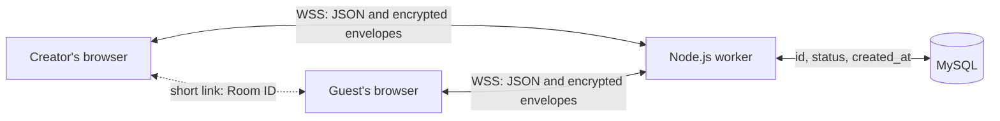
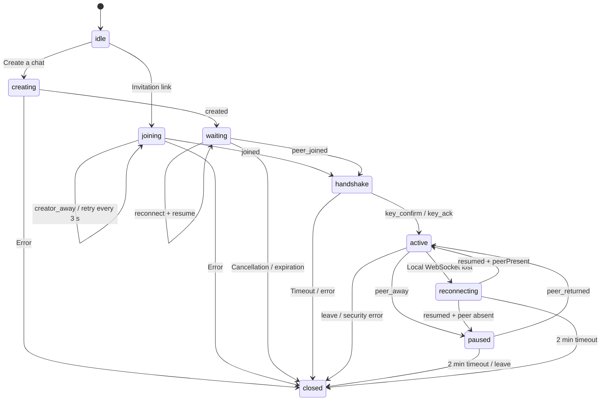
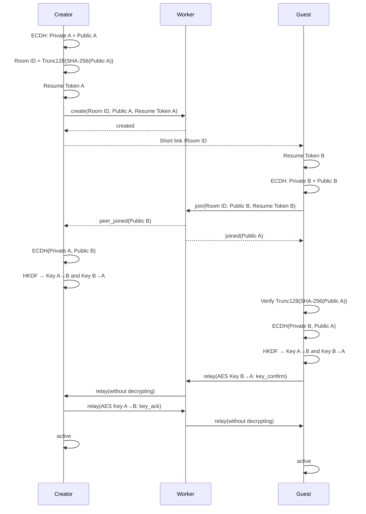

# burnit.chat — technical documentation

This document describes the current burnit.chat implementation: frontend
and production configuration, the HTTP/WebSocket worker, the room lifecycle,
the message protocol, and the step-by-step creation of an encrypted channel.

For an accessible explanation of key exchange, the handshake, message
encryption, and transport resumption using equations, also see
[key-exchange.md](key-exchange.md).

This document covers the production Node.js worker in
`server/node-relay.cjs`. The `server/server.php` file is an older reference
implementation. It does not support the current short-link protocol and is
not used in production.

## 1. What is burnit.chat?

burnit.chat is a disposable 1:1 chat that:

- Requires no accounts or sign-in.
- Does not store message contents.
- Encrypts messages in the browsers before sending them.
- Allows only the first guest to join.
- Allows the creator and guest to return to an active conversation within
  2 minutes after a temporary WebSocket disconnection.
- Destroys the room after an explicit end, a security error, or expiration
  of the reconnection window.
- Keeps connection state and session keys only in memory.

The WebSocket worker is a relay. It validates room state and frame format
but does not decrypt messages.

## 2. Architecture

| Component | Responsibility |
|---|---|
| `index.php` | Selects the language and serves the appropriate chat template |
| `index.html`, `index.en.html` | Polish and English chat templates |
| `info.php` | Selects the language for the information page |
| `jak-to-dziala.html`, `how-it-works.html` | Polish and English information page templates |
| `set-language.php` | Saves a manual language selection in a cookie |
| `lib/locale.php` | Identifies Polish IP addresses locally |
| `data/pl-ip-ranges.json` | Generated IPv4 and IPv6 ranges from RIPE NCC |
| `config.js` | Public application URL and WebSocket endpoint |
| `assets/app.js` | UI state, client protocol, and handshake |
| `assets/i18n.js` | English translations of dynamic messages |
| `assets/crypto.js` | ECDH, HKDF, AES-GCM, sequences, and security code |
| `server/node-relay.cjs` | Production HTTP/WebSocket worker |
| `database/schema.sql` | Table for temporary room state |
| `tools/push.py` | Controlled deployment over SSH |
| `tools/ws-healthcheck.cjs` | Production `create → created → leave` test over WSS |
| `test/crypto.test.js` | Cryptography and replay-protection tests |
| `test/server-integration.js` | Full worker protocol test |
| `key-exchange.md` | Step-by-step explanation of ECDH, HKDF, AES-GCM, and the handshake |
| `SECURITY.md` | Brief threat model and limitations |



### 2.1. What is kept in memory

The browser holds:

- The participant's private and public ECDH keys.
- The other participant's public key.
- Two directional AES keys.
- Sending and receiving sequence counters.
- Decrypted messages visible in the current DOM.
- The creator's or guest's own resume token.

The worker's memory holds:

- Active WebSocket connections.
- Room ID and state.
- The role of each connection.
- The pairing between the two sockets.
- The creator's public key until the room is destroyed.
- The guest's public key while forwarding it to the creator.
- Separate hashes of the creator's and guest's resume tokens.
- Creation times and separate reconnection deadlines for both roles.

MySQL stores only:

- `id`.
- `status`, either `waiting` or `active`.
- `created_at`.

Message contents, ECDH keys, AES keys, resume tokens, and encrypted envelopes
are not stored in MySQL.

## 3. Requirements

### 3.1. Runtime

- Node.js 18 or newer; use a current LTS release in production.
- npm.
- The `ws` and `mysql2` packages.
- A browser with the Web Crypto API.
- A secure HTTPS context in production.
- WSS in production.
- MySQL when using `NODE_ENV=production`.

### 3.2. Local installation

```powershell
npm install
npm run check
npm test
npm run test:integration
```

Start the worker:

```powershell
npm start
```

Or use:

```text
server\start-relay.cmd
```

Default local endpoint:

```text
ws://localhost:8080/ws
```

Outside `production` mode, the database is optional. Without MySQL
configuration, the worker stores room state entirely in memory.

## 4. Frontend configuration

The public configuration is in `config.js`.

```js
window.SAFECHAT_CONFIG = Object.freeze({
    publicBaseUrl: 'https://burnit.chat/',
    websocketUrl: 'wss://burnit.chat/ws/',
    debug: false
});
```

| Field | Meaning |
|---|---|
| `publicBaseUrl` | Base URL for the invitation link |
| `websocketUrl` | WebSocket worker endpoint |
| `debug` | Enables detailed client logs |

Current behavior:

- For `burnit.chat` and `www.burnit.chat`, invitation links point to
  `https://burnit.chat/`.
- The production WebSocket URL is `wss://<current-host>/ws/`.
- Locally, the base URL is calculated from the current page address.
- The local WebSocket URL is `ws://localhost:8080/ws`.
- A page opened over HTTPS rejects a configuration using `ws://`.

### 4.1. Invitation route

The complete link has this format:

```text
https://burnit.chat/<ROOM_ID>
```

Example structure:

```text
https://burnit.chat/AAAAAAAAAAAAAAAAAAAAAA
```

The path contains a 22-character room identifier. It consists of the first
16 bytes of the `SHA-256` hash of the raw, 65-byte `Public A`, encoded as
base64url. This makes the short identifier itself a 128-bit commitment to
the creator's key.

The full `Public A` is not included in the link. The creator sends it to the
worker in `create`; the worker keeps it only in RAM and returns it to the
guest in `joined`. Before performing ECDH, the guest recalculates the
identifier from the received key and requires it to match the invitation URL.

`.htaccess` routes paths that look like room identifiers to `index.php`.
PHP selects the Polish or English template, and the frontend reads `ROOM_ID`
from the unchanged URL.

### 4.2. Browser policies and headers

`index.html` sets a CSP that restricts resources to the application's own
domain and permits `ws:` and `wss:` connections.

`.htaccess` sets the following headers, among others:

- `X-Content-Type-Options: nosniff`.
- `X-Frame-Options: DENY`.
- `Referrer-Policy: no-referrer`.
- A restricted `Permissions-Policy`.
- `Cross-Origin-Opener-Policy: same-origin`.
- `Cross-Origin-Resource-Policy: same-origin`.
- `Cache-Control: no-store`.

### 4.3. Language selection

`index.php` and `info.php` call `burnit_language()` from `lib/locale.php`.
The selection order is:

1. A valid `pl` or `en` value in the `burnit_lang` cookie.
2. For a public IP address, a lookup in the local list of Polish IP ranges.
3. For a private or loopback address, the `Accept-Language` header.
4. English for a public address outside the Polish ranges.

The language-selection mechanism neither sends the IP address to a
geolocation service nor stores it. `data/pl-ip-ranges.json` is generated
from RIPE NCC's daily delegation statistics:

```powershell
python tools\update-polish-ip-ranges.py
```

The generator merges IPv4 and IPv6 delegations for `PL`. Refresh the list
before deployment or periodically after allocation changes. English
templates are generated from the Polish source files:

```powershell
python tools\build-english-pages.py
```

Clicking a flag calls `set-language.php`, which accepts only a supported
language and a return destination from an explicit allowlist. The cookie
has `HttpOnly`, `SameSite=Lax`, path `/`, a one-year lifetime, and `Secure`
on HTTPS. The switch is hidden once a session starts because reloading the
page would remove the temporary keys from the tab's memory.

## 5. Node.js worker configuration

### 5.1. Environment variables

| Variable | Default | Minimum | Maximum | Production |
|---|---:|---:|---:|---|
| `NODE_ENV` | Unset, treated as development | — | — | `production` |
| `PORT` | `8080` | `1` | `65535` | Port controlled by the LiteSpeed runtime |
| `BURNIT_WS_PATH` | `/ws` | — | — | `/ws` |
| `BURNIT_INITIAL_REQUEST_TIMEOUT_MS` | `20000` | `5000` | `120000` | `20000` |
| `BURNIT_WAITING_TTL_MS` | `900000` | `60000` | `3600000` | `900000` |
| `BURNIT_RECONNECT_GRACE_MS` | `120000` | `10000` | `300000` | `120000` |
| `BURNIT_MAX_FRAME_BYTES` | `70000` | `4096` | `262144` | `70000` |
| `BURNIT_RATE_LIMIT_MESSAGES` | `60` | `10` | `1000` | `60` |
| `BURNIT_RATE_LIMIT_WINDOW_MS` | `10000` | `1000` | `60000` | `10000` |
| `BURNIT_LOG_LEVEL` | `info` in production, otherwise `debug` | — | — | `info` |
| `BURNIT_ALLOWED_ORIGINS` | Environment-dependent | — | — | Exact list of origins |
| `BURNIT_DB_HOST` | `localhost` | — | — | Host from the control panel |
| `BURNIT_DB_PORT` | `3306` | `1` | `65535` | `3306` |
| `BURNIT_DB_NAME` | Empty | — | — | Required |
| `BURNIT_DB_USER` | Empty | — | — | Required |
| `BURNIT_DB_PASSWORD` | Empty | — | — | Required |

Numeric values outside the range are clamped to the specified minimum or
maximum. An invalid numeric value falls back to the default. The old
`BURNIT_CREATOR_RECONNECT_GRACE_MS` name is still read for backward
compatibility, but new configurations should use `BURNIT_RECONNECT_GRACE_MS`
because the limit applies to both roles.

`LSNODE_SOCKET` is an internal variable injected by LiteSpeed. The worker
uses it to recognize CAL.pl hosting. Do not set it manually for a standard
Node startup.

Recommended production settings:

```dotenv
NODE_ENV=production
BURNIT_ALLOWED_ORIGINS=https://burnit.chat,https://www.burnit.chat
BURNIT_WS_PATH=/ws
BURNIT_LOG_LEVEL=info

BURNIT_DB_HOST=localhost
BURNIT_DB_PORT=3306
BURNIT_DB_NAME=your_database_name
BURNIT_DB_USER=your_database_user
BURNIT_DB_PASSWORD=replace_with_a_new_password
```

Never publish a file containing real secrets in `public_html`, upload it
through `tools/push.py`, or add it to the repository.

### 5.2. Allowed origins

`BURNIT_ALLOWED_ORIGINS` is a comma-separated list. The worker compares the
`Origin` header against exact values in the set.

Production:

```text
https://burnit.chat,https://www.burnit.chat
```

The default local environment also allows:

```text
http://localhost
http://127.0.0.1
http://safechat.test
```

A missing or disallowed `Origin` during an upgrade attempt results in HTTP 403.

### 5.3. Log levels

Available levels:

```text
debug < info < warning < error < off
```

Logs are individual JSON objects. The worker logs the following events and
metadata, among others:

- Service startup and readiness.
- WebSocket connections and closures.
- Room creation, resumption, locking, and destruction.
- Protocol and database errors.
- A truncated, 10-character SHA-256 room tag.
- The size of the forwarded ciphertext.

The worker does not log:

- Message contents.
- Public, private, or AES keys.
- Resume tokens.
- IVs or ciphertext.
- IP addresses.

## 6. MySQL

Schema:

```sql
CREATE TABLE IF NOT EXISTS rooms (
    id VARCHAR(32) CHARACTER SET ascii COLLATE ascii_bin NOT NULL,
    status ENUM('waiting', 'active') NOT NULL DEFAULT 'waiting',
    created_at TIMESTAMP NOT NULL DEFAULT CURRENT_TIMESTAMP,
    PRIMARY KEY (id),
    INDEX idx_rooms_status_created (status, created_at)
) ENGINE=InnoDB;
```

At startup, the worker:

1. Connects to the database with a 10-second timeout.
2. Executes `CREATE TABLE IF NOT EXISTS`.
3. Acquires a `GET_LOCK` lock during a standard startup outside LiteSpeed.
4. Skips the connection lock on CAL.pl because the runtime can briefly
   overlap worker lifecycles.
5. Deletes all orphaned `rooms` records.
6. Becomes ready.

With `NODE_ENV=production`, a missing database name, user, or password
prevents the service from starting.

Room operations:

| Operation | SQL |
|---|---|
| Creation | `INSERT ... status = 'waiting'` |
| First join | Atomic `UPDATE waiting → active` |
| Closure or expiration | `DELETE FROM rooms WHERE id = ?` |

If the database connection is lost, the worker:

1. Closes clients with WebSocket code 1011.
2. Stops accepting connections.
3. Exits the process.
4. Allows the runtime to start a clean instance.

## 7. Worker startup and health checks

The worker calls `server.listen()` synchronously while `app.cjs` is loading.
This is required by the `lsnode.js` loader on CAL.pl. Database initialization
starts only after the socket is bound.

HTTP states:

| State | Code | Response |
|---|---:|---|
| Unknown path | 404 | `{"status":"not_found"}` |
| Database still initializing | 503 | `{"service":"burnit.chat-relay","status":"starting"}` |
| Worker ready | 200 | `{"service":"burnit.chat-relay","status":"ok"}` |

Health-check endpoint:

```text
https://burnit.chat/ws/
```

HTTP 200 alone does not confirm that WebSocket upgrades work. Deployment
therefore also runs a WSS test that:

1. Connects to `wss://burnit.chat/ws/`.
2. Sends a valid `create` message.
3. Requires a `created` response.
4. Sends `leave`.
5. Requires the test room to close.

## 8. WebSocket worker

### 8.1. Upgrade

The worker uses `WebSocketServer` in `noServer` mode.

An upgrade is accepted only when:

1. The path is `/`, `/ws`, or `/ws/`.
2. The worker has finished initializing the database.
3. `Origin` is included in `BURNIT_ALLOWED_ORIGINS`.

Settings for the `ws` library:

- Built-in client tracking is disabled; the worker maintains its own client
  map.
- The maximum payload is controlled by `BURNIT_MAX_FRAME_BYTES`.
- `perMessageDeflate` is disabled.

### 8.2. Client state in the worker

Each connection has:

| Field | Meaning |
|---|---|
| `traceId` | Random diagnostic connection identifier |
| `roomId` | Room or `null` |
| `role` | `creator`, `guest`, or `null` |
| `peer` | The other participant's socket |
| `rateWindowAt` | Start of the rate-limit window |
| `rateCount` | Number of frames in the window |
| `isAlive` | Heartbeat state |
| `cleaned` | Protection against duplicate cleanup |
| `processing` | Promise chain that preserves frame order |
| `initialRequestTimer` | First-message timeout |

Messages from a single client are processed sequentially. A later frame
cannot overtake the previous asynchronous MySQL operation.

### 8.3. Room state in the worker

| Field | Meaning |
|---|---|
| `creator` | Creator's socket, or `null` during the grace period |
| `guest` | Guest's socket, or `null` during the grace period |
| `status` | `waiting` or `active` |
| `createdAt` | Creation time |
| `creatorPublicKey` | Creator's public ECDH key, forwarded to the guest |
| `creatorResumeTokenHash` | SHA-256 of the creator's token |
| `guestResumeTokenHash` | SHA-256 of the guest's token, or `null` before `join` |
| `creatorReconnectUntil` | Creator's reconnection deadline, or `null` |
| `guestReconnectUntil` | Guest's reconnection deadline, or `null` |

### 8.4. Validation and limits

The worker accepts only text frames containing JSON.

| Data | Format |
|---|---|
| `roomId` | 22 base64url characters; first 16 bytes of SHA-256 of raw `Public A` |
| `resumeToken` | 43 base64url characters; originally 32 random bytes |
| Public key | 87 base64url characters; 65 bytes of uncompressed P-256 |
| IV | 16 base64url characters; 12 bytes |
| Ciphertext | base64url, 22 to 87382 characters |

The default rate limit is 60 frames per 10 seconds per connection. Exceeding
the limit ends the connection with a `rate_limited` error.

After opening the WebSocket, a client has 20 seconds by default to send its
first valid `create`, `join`, or `resume` message. Otherwise, the worker closes
the connection with code 1008 and reason `timeout`.

Every 30 seconds, the worker sends a ping. If the client does not respond
with a pong before the next cycle, the socket is terminated.

## 9. Public WebSocket protocol

All protocol frames are JSON objects.

### 9.1. Client → worker

#### `create`

```json
{
  "type": "create",
  "roomId": "22-character-base64url",
  "publicKey": "87-character-creator-public-key",
  "resumeToken": "43-character-base64url"
}
```

The worker checks that `roomId` equals the first 16 bytes of
`SHA-256(publicKey)`, encoded as base64url. It keeps the creator's public key
and token hash only in RAM. The token is not included in the link or MySQL.

#### `resume`

```json
{
  "type": "resume",
  "roomId": "22-character-base64url",
  "resumeToken": "43-character-base64url"
}
```

The same message serves both roles. The worker identifies the role from the
token hash, checks its separate reconnection deadline, and compares the hashes
using `crypto.timingSafeEqual`.

#### `join`

```json
{
  "type": "join",
  "roomId": "22-character-base64url",
  "publicKey": "87-character-guest-public-key",
  "resumeToken": "43-character-base64url"
}
```

`publicKey` is the guest's public ECDH key. The worker forwards it to the
creator. `resumeToken` is the guest's new private token. The worker stores
only its SHA-256 hash and uses it solely for that guest's reconnection.

#### `relay`

```json
{
  "type": "relay",
  "payload": {
    "v": 1,
    "iv": "16-character-base64url",
    "ciphertext": "base64url"
  }
}
```

The worker validates only the outer envelope and forwards it to the other
socket. It does not know the `kind` field, sequence number, timestamp, or data
inside the ciphertext.

#### `ping`

```json
{"type":"ping"}
```

The application-level response is `pong`. This mechanism is independent of
the WebSocket ping/pong control frames sent by the worker.

#### `leave`

```json
{"type":"leave"}
```

Immediately destroys the room and notifies the other participant.

### 9.2. Worker → client

| Type | Meaning |
|---|---|
| `created` | The room has been created |
| `resumed` | The creator or guest has resumed their connection; includes `roomState` and `peerPresent` |
| `peer_joined` | A guest has joined the creator; includes the guest's public key |
| `joined` | The worker has accepted the guest; includes the creator's public key |
| `relay` | Encrypted envelope from the other participant |
| `peer_away` | The other participant temporarily lost their connection; includes the reconnection window length |
| `peer_returned` | The other participant returned to the same active room |
| `pong` | Response to an application-level `ping` |
| `force_close` | The room was destroyed by the other participant or expired |
| `error` | Protocol error with a code in the `code` field |

Example of forwarding the guest's public key:

```json
{
  "type": "peer_joined",
  "publicKey": "87-character-guest-public-key"
}
```

Example of forwarding the creator's public key:

```json
{
  "type": "joined",
  "publicKey": "87-character-creator-public-key"
}
```

Example error:

```json
{
  "type": "error",
  "code": "room_locked"
}
```

### 9.3. Error codes

| Code | Meaning |
|---|---|
| `room_not_found` | The room does not exist or has expired |
| `creator_away` | The creator is within the reconnection window; the guest frontend retries `join` |
| `resume_denied` | Invalid token, state, or resumption timing |
| `room_locked` | A guest has already joined or the record is not `waiting` |
| `room_exists` | Room identifier collision |
| `invalid_request` | Invalid type, format, state, or payload |
| `rate_limited` | Frame rate limit exceeded |
| `server_error` | Unhandled processing error |

Protocol errors are sent before closing the WebSocket with code 1008.

### 9.4. Main WebSocket close codes

| Code | Usage |
|---:|---|
| `1000` | Normal session end or room destruction |
| `1001` | Worker restart |
| `1008` | Policy/protocol error, timeout, or validation failure |
| `1011` | Loss of the required database |

## 10. Browser-side session states



| Phase | Meaning |
|---|---|
| `idle` | Home screen |
| `creating` | Generating creator data and sending `create` |
| `waiting` | The room exists and is waiting for its first guest |
| `joining` | The guest prepares keys, sends `join`, and retries if necessary |
| `handshake` | The participants have AES keys and confirm encryption works |
| `active` | Messages can be sent |
| `paused` | The channel and messages are preserved, but the peer is temporarily offline |
| `reconnecting` | The browser is rebuilding its own WSS transport to the same room |
| `closed` | The room and key references have been removed |

## 11. Creating a secure channel — step by step

### 11.1. Algorithms used

| Purpose | Algorithm |
|---|---|
| Secret agreement | ECDH on the P-256 curve |
| Key derivation | HKDF-SHA-256 |
| Encryption | AES-256-GCM |
| Randomness | `crypto.getRandomValues` and Web Crypto |
| Hashing | SHA-256 |
| Binary encoding | base64url without `=` |

Private ECDH keys and AES keys are created as non-exportable `CryptoKey`
objects.

### 11.2. Two layers of protection

The connection uses two distinct layers:

1. **HTTPS/WSS (TLS)** protects transport between each browser and the hosting
   platform. It hides traffic from network observers but terminates at the
   server.
2. **End-to-end encryption** operates inside WSS. Plaintext is encrypted with
   keys known only to the two browsers, so the worker forwards ciphertext
   without being able to decrypt it.

WSS does not replace E2EE, and E2EE does not replace properly configured TLS.

### 11.3. Step 1 — the creator prepares the room

After clicking “Create a chat”, the creator's browser generates:

1. An ECDH P-256 pair:
   - Private key `Private A`.
   - Public key `Public A`.
2. `Room ID`: the first 16 bytes of `SHA-256` of raw `Public A`, encoded as
   22 base64url characters.
3. `Resume Token A`: 32 random bytes, encoded as 43 base64url characters.

`Private A` remains in the creator's browser memory and is non-exportable.
`Public A` is exported in uncompressed P-256 format:

```text
0x04 || X(32 bytes) || Y(32 bytes)
```

Its total length is 65 bytes, or 87 base64url characters.

The identifier is calculated as follows:

```text
Room ID = base64url(Trunc128(SHA-256(raw Public A)))
```

The creator opens a WSS connection and sends:

```text
create(Room ID, Public A, Resume Token A)
```

The worker:

1. Validates the P-256 key format.
2. Independently calculates the identifier from `Public A` and requires a match.
3. Inserts `Room ID` into MySQL with status `waiting`.
4. Stores `Public A` and the SHA-256 hash of the resume token only in RAM.
5. Responds with `created`.

### 11.4. Step 2 — the invitation link is created

After `created`, the browser constructs:

```text
https://burnit.chat/<Room ID>
```

The link contains only the room identifier. This includes a 128-bit
commitment to `Public A`, but not the full 87-character key.

The link does not contain:

- The full `Public A`.
- `Private A`.
- The resume token.
- Any AES key.

The short link is a bearer invitation: its holder can try to become the
first guest.

### 11.5. Step 3 — the guest opens the link

The guest's browser:

1. Reads `Room ID` from the path.
2. Validates its length and base64url encoding.
3. Generates its own `Resume Token B`: 32 random bytes encoded as base64url.
4. Generates a new ECDH P-256 pair:
   - Private key `Private B`.
   - Public key `Public B`.

`Private B` never leaves the guest's browser.

### 11.6. Step 4 — the worker exchanges public keys

The guest sends:

```text
join(Room ID, Public B, Resume Token B)
```

The worker changes the MySQL record atomically:

```text
waiting → active
```

Only the first valid `join` can succeed. The worker then:

1. Stores the SHA-256 hash of the guest's resume token.
2. Preserves the creator's token hash for the active conversation.
3. Pairs the two sockets.
4. Sends `peer_joined(Public B)` to the creator.
5. Sends `joined(Public A)` to the guest.

Both participants' public keys pass through the worker. Private keys,
the `Shared Secret`, and AES keys never reach it.

### 11.7. Step 5 — the guest checks the commitment and derives keys

Before importing the key, the guest calculates:

```text
Expected Room ID = base64url(Trunc128(SHA-256(raw Public A)))
```

If the result does not exactly match `Room ID` in the link, the guest closes
the room before ECDH. The worker therefore cannot substitute `Public A`
undetected without finding another key with the same 128-bit hash.

The guest imports `Public A` and performs:

```text
Shared Secret = ECDH(Private B, Public A)
```

The result is a 256-bit shared secret.

The guest then constructs the salt material:

```text
safechat:v1:<Room ID>:<Public A>:<Public B>
```

And calculates its SHA-256 hash:

```text
Salt = SHA-256(UTF8(salt material))
```

HKDF-SHA-256 derives two independent keys from the `Shared Secret` and `Salt`:

```text
Key A→B = HKDF(info = "safechat:v1:creator-to-guest")
Key B→A = HKDF(info = "safechat:v1:guest-to-creator")
```

Both are 256-bit, non-exportable AES-GCM keys.

The guest assigns:

- Sending key: `Key B→A`.
- Receiving key: `Key A→B`.

### 11.8. Step 6 — the creator derives the same keys

The creator imports `Public B` and performs:

```text
Shared Secret = ECDH(Private A, Public B)
```

ECDH guarantees:

```text
ECDH(Private A, Public B) = ECDH(Private B, Public A)
```

The creator uses exactly the same:

- `Room ID`.
- `Public A`.
- `Public B`.
- Salt material.
- HKDF `info` labels.

The creator therefore obtains identical `Key A→B` and `Key B→A` values, but
assigns them in the opposite direction:

- Sending key: `Key A→B`.
- Receiving key: `Key B→A`.

No shared secret or AES key is transmitted over the network.

### 11.9. Step 7 — key confirmation

Key derivation alone is not enough. Both participants must prove that they
can encrypt and decrypt in the appropriate directions.

Application handshake:

1. After receiving `joined`, the guest encrypts the following using `Key B→A`:

   ```json
   {
     "kind": "key_confirm",
     "seq": 1,
     "sentAt": 1710000000000,
     "proof": "safechat-v1"
   }
   ```

2. The worker sees only a `relay` envelope and forwards it to the creator.
3. The creator decrypts it using `Key B→A`.
4. The creator checks `kind`, `proof`, the sequence number, and session state.
5. The creator encrypts the following using `Key A→B`:

   ```json
   {
     "kind": "key_ack",
     "seq": 1,
     "sentAt": 1710000000000,
     "proof": "safechat-v1"
   }
   ```

6. The worker again only forwards the envelope.
7. The guest decrypts it using `Key A→B`.
8. The guest checks `kind`, `proof`, the sequence number, and state.
9. Both participants enter the `active` phase.

The creator activates the interface after successfully decrypting
`key_confirm` and sending `key_ack`. The guest activates the interface after
successfully decrypting `key_ack`.

The handshake has a 15-second timeout.



### 11.10. Which participant knows which keys

| Data | Creator | Guest | Worker | MySQL |
|---|:---:|:---:|:---:|:---:|
| `Room ID` | Yes | Yes | Yes | Yes |
| `Public A` | Yes | Yes | Yes, in RAM and during `create/joined` | No |
| `Private A` | Yes | No | No | No |
| `Public B` | Yes | Yes | Temporarily | No |
| `Private B` | No | Yes | No | No |
| `Shared Secret` | Yes | Yes | No | No |
| `Key A→B` | Yes | Yes | No | No |
| `Key B→A` | Yes | Yes | No | No |
| Own resume token | Yes | Yes | During `create/join/resume` | No |
| SHA-256 of both resume tokens | No | No | Yes, in RAM | No |
| Plaintext message | Yes | Yes | No | No |
| Ciphertext in transit | Yes | Yes | Yes | No |

The worker knows both public keys, but they do not allow it to calculate the
secret without one of the private keys. The operator hosting the frontend
can still modify JavaScript or observe other metadata; this is covered in
the security limitations.

## 12. Security code

Both participants independently calculate:

```text
Verification Digest = SHA-256(Shared Secret || Salt)
```

The first 32 bits of the hash are interpreted as an unsigned integer, then:

```text
Verification Number = value mod 1 000 000 000
```

The result is displayed as nine digits:

```text
123 456 789
```

If both participants see the same code, they used the same shared secret
and session parameters. For high-risk conversations, compare the code
through another trusted channel.

The code helps detect active substitution of the guest's public key by a
malicious relay or modified infrastructure. Merely displaying the code
without comparing it does not authenticate the other participant.

## 13. Encrypting each message

### 13.1. Plaintext payload before encryption

Inside the browser, an application message has this format:

```json
{
  "kind": "message",
  "seq": 2,
  "sentAt": 1710000000000,
  "text": "Message contents"
}
```

Fields:

| Field | Meaning |
|---|---|
| `kind` | `key_confirm`, `key_ack`, or `message` |
| `seq` | Increasing sequence number, separate for each direction |
| `sentAt` | Client time in Unix milliseconds |
| Other fields | Data depending on `kind` |

The maximum message text length is 4000 characters.

### 13.2. AES-256-GCM

For each outgoing message, the browser:

1. Increments the sending counter.
2. Generates a new random 12-byte IV.
3. Serializes the payload to UTF-8 JSON.
4. Constructs AAD.
5. Encrypts with the appropriate directional AES-256-GCM key.
6. Uses a 128-bit authentication tag.
7. Encodes the IV and ciphertext with its tag as base64url.

AAD:

```text
safechat:v1:<Room ID>:<sender role>
```

The sender's role is `creator` or `guest`.

AAD is not secret, but it is authenticated by AES-GCM. It prevents an
envelope from being used successfully:

- In another room.
- In another direction.
- For another role.
- With another protocol version.

Outer envelope:

```json
{
  "v": 1,
  "iv": "base64url-of-12-bytes",
  "ciphertext": "base64url-of-ciphertext-and-tag"
}
```

### 13.3. Receiving

The receiver:

1. Checks the envelope version.
2. Decodes the IV and ciphertext.
3. Requires a 12-byte IV.
4. Requires ciphertext between 16 bytes and 64 KiB.
5. Reconstructs AAD for the other participant's role.
6. Performs AES-GCM decryption.
7. Decodes UTF-8 and JSON.
8. Requires exactly the next `seq` number.
9. Checks `kind` against the current session phase.

A repeated frame, skipped sequence number, or reordering closes the secure
channel.

## 14. Room lifecycle

### 14.1. Waiting

After `create`:

- The worker's room state is `waiting`.
- Only the creator is connected.
- The creator's resume token is active.
- The room can wait for up to 15 minutes by default.
- The first valid guest can lock the room.

### 14.2. First guest

`UPDATE rooms SET status = 'active' WHERE id = ? AND status = 'waiting'`
is atomic. After it succeeds:

- Further guests are rejected.
- The worker has separate hashes of the creator's and guest's tokens.
- Both participants can return to the same active conversation after a
  temporary disconnection.

### 14.3. Tokens and connection resumption

Each participant has their own independent resume token:

- The creator generates it before `create`.
- The guest generates it before the first `join`.
- The worker stores only the SHA-256 hashes of both tokens.
- One role's token cannot resume the other role's connection.

An unintentional socket disconnection starts a separate reconnection window
for that role, lasting 120 seconds by default. The frontend also tries for
up to 120 seconds.

The frontend uses increasing retry intervals:

```text
Approximately 1 s, 2 s, 4 s, up to 5 s
```

If the tab is hidden, the attempt is deferred. The frontend resumes
connecting when the tab becomes visible again.

The token:

- Exists only in the relevant tab's memory.
- Is not included in the URL.
- Is not persisted by the frontend.
- Is transmitted only over WSS.
- Is compared through its hash in constant time.

### 14.4. Interruption during an active conversation

When an active participant loses their WebSocket connection, the worker:

1. Detaches only their old socket.
2. Preserves the room, roles, and token hashes.
3. Sets a separate 2-minute reconnection deadline for that role.
4. Sends `peer_away` to the connected peer.

Both browsers retain the existing `SecureChannel`, AES keys, security code,
messages, and sequence counters in memory. The message input is temporarily
disabled to avoid creating envelopes that cannot be delivered. Resumption
does not perform ECDH or HKDF again and does not reset counters.

The disconnected participant's browser opens a new WSS connection and sends:

```text
resume(Room ID, own Resume Token)
```

After a successful `resumed` response, the worker reassigns the socket to the
same role. If the peer is connected, it receives `peer_returned`, and both
participants return to `active`. If the peer is also temporarily offline,
the returning participant remains `paused` and waits for the peer's separate
`resume`.

A transport interruption does not change the channel's cryptographic
identity. The next message uses the next `seq` number, as if the WebSocket
had never disconnected.

### 14.5. Guest waiting for the creator to return

If a guest opens the invitation after the creator has lost their WebSocket
connection, the worker returns:

```json
{
  "type": "error",
  "code": "creator_away"
}
```

The guest frontend does not close the session or require a manual refresh.
It keeps the following in memory:

- `Room ID`.
- Its own `Private B` and `Public B` pair.
- Its own resume token.

The sequence is:

1. The frontend displays “Creator temporarily unavailable”.
2. The rejected worker socket closes.
3. The frontend opens a new WSS connection after 3 seconds.
4. It sends `join(Room ID, Public B, Resume Token B)` again.
5. It retries every 3 seconds for up to 2 minutes.

If the creator sends `resume` first, the next `join` is accepted. The guest
then receives `Public A`, verifies its commitment against `Room ID`, derives
the keys, and starts the `key_confirm → key_ack` handshake. Other errors,
such as `room_not_found` or `room_locked`, still end the session immediately.

After two minutes without success, the frontend removes the keys and asks
for a new invitation.

### 14.6. Room destruction

An active room is destroyed when:

- One participant sends `leave`.
- One participant fails to return within 2 minutes of losing their WebSocket.
- A protocol error occurs.
- The database stops working.
- The worker restarts.
- The room timeout expires.

The worker:

1. Removes the room from memory.
2. Deletes the MySQL record.
3. Sends `force_close` to the peer if available.
4. Closes the peer's socket.

The frontend:

1. Stops timers.
2. Destroys the `SecureChannel`.
3. Removes key references.
4. Clears messages from the DOM.
5. Removes the room identifier from the URL.

JavaScript does not guarantee immediate physical memory zeroing by the
garbage collector. Removing references limits the lifetime of data but is
not equivalent to a low-level `memset`.

## 15. Screen Wake Lock

In phases other than `idle` and `closed`, the frontend tries to keep the
screen awake. This reduces the risk of the phone going to sleep and
disconnecting the WebSocket.

Wake Lock:

- Is acquired only for a visible tab.
- Can be released automatically by the browser.
- Is requested again when the tab becomes visible.
- Does not block encryption or chat if unavailable.

## 16. Security model

### 16.1. What the protocol provides

- Content leaves the browser only after AES-256-GCM encryption.
- The worker does not have the keys needed for decryption.
- Each direction has a separate AES key.
- GCM provides confidentiality and integrity.
- AAD binds the envelope to the room, role, and version.
- Sequences detect replay and reordering.
- The first guest locks the room.
- The security code allows manual key verification.

### 16.2. What the infrastructure can see

The HTTPS/WSS operator can know:

- IP addresses at the network infrastructure level.
- Connection timing and duration.
- Frame sizes and frequency.
- Room identifier and state.
- Both public keys forwarded by the worker.

The worker code deliberately does not log IP addresses, but the network
transport itself does not hide them from the hosting provider.

### 16.3. Limitations

1. **Link stolen before first use.** Anyone with the complete link can join
   as the first guest.
2. **Malicious frontend.** Modified JavaScript can capture data before
   encryption. HTTPS and deployment control are part of the trust model.
3. **Malicious relay.** `Public A` is pinned by `Room ID`, but the relay can
   try to substitute the guest's public key when forwarding it to the
   creator. Manual comparison of the security code detects the difference.
4. **Endpoint device.** Malware, extensions, the clipboard, screenshots,
   and someone looking at the screen are outside the scope of E2EE.
5. **No Double Ratchet.** One ECDH pair and two AES keys serve the entire
   short session. There is no per-message key rotation.
6. **No persistent identity.** The code confirms matching session keys,
   not the other participant's name or account.

## 17. Production on CAL.pl

### 17.1. Directories

Frontend:

```text
/home/pemoarts/domains/burnit.chat/public_html
```

Worker:

```text
/home/pemoarts/domains/burnit.chat/node_app
```

### 17.2. Node.js application settings

| Control panel field | Value |
|---|---|
| Node.js version | Current LTS, minimum 18 |
| Application mode | `Production` |
| Application root | `domains/burnit.chat/node_app` |
| Application URL | `burnit.chat`, path `/ws` |
| Startup file | `app.cjs` |

After the initial installation, install npm dependencies from the control
panel.

### 17.3. Deployment

Preview operations:

```powershell
python tools\push.py --dry-run
```

Deploy everything:

```powershell
python tools\push.py
```

Frontend only:

```powershell
python tools\push.py --component public
```

Worker only:

```powershell
python tools\push.py --component node
```

Worker deployment:

1. Uploads `server/node-relay.cjs` as `app.cjs`.
2. Uploads `package.json` and `package-lock.json`.
3. Reads the hosting user's process list.
4. Selects only the exact title:

   ```text
   lsnode:/home/pemoarts/domains/burnit.chat/node_app/
   ```

5. Sends `TERM`.
6. Verifies for 5 seconds that those exact PIDs have exited.
7. Uses `KILL` for PIDs that still exist and have been verified again.
8. Sets `tmp/restart.txt`.
9. Waits up to 45 seconds for the correct health JSON.
10. Runs the WSS `create → created → leave` test.

The script does not use a broad `pkill node` and should not affect other
Node applications on the account.

Deploying the worker disconnects existing rooms. This is consistent with
the disposable, in-memory session model, but deployments should be planned
with this behavior in mind.

## 18. Tests

### 18.1. Syntax checks

```powershell
npm run check
```

Checks:

- `assets/app.js`.
- `assets/crypto.js`.
- `server/node-relay.cjs`.
- `tools/ws-healthcheck.cjs`.

### 18.2. Cryptography tests

```powershell
npm test
```

These check the following, among other things:

- Matching keys on both sides.
- Separate keys for each direction.
- Rejection of a repeated frame.
- Prevention of envelope reuse in another room.
- Preservation of keys and counter continuity after a transport interruption.
- Deterministic calculation of the 128-bit `Room ID` from `Public A`.

### 18.3. Local worker integration

```powershell
npm run test:integration
```

The test starts a local worker and checks:

- The health endpoint.
- Rejection of a disallowed Origin.
- Rejection of `create` when `Room ID` does not match `Public A`.
- Room creation and forwarding of `Public A` to the guest.
- Secure resumption.
- Rejection of an invalid token.
- The first join and room locking.
- Ciphertext forwarding.
- Creator resumption in an active room.
- Guest resumption in an active room.
- Disconnection and return of both participants.
- `peer_away` and `peer_returned` messages.
- `force_close`.

### 18.4. Full production test

```powershell
$env:BURNIT_TEST_WS = 'wss://burnit.chat/ws/'
npm run test:integration
Remove-Item Env:BURNIT_TEST_WS
```

The test creates a temporary production room and does not send real
conversation contents.

## 19. Troubleshooting

### 19.1. `/ws/` times out

Check the following in order:

1. `https://burnit.chat/` — whether the frontend works.
2. `https://burnit.chat/ws/` — whether the exact health JSON appears.
3. `stderr.log` in the `node_app` directory.
4. Whether the `mysql2` and `ws` dependencies exist in the Node environment.
5. Whether the Node version is at least 18.
6. Whether all required `BURNIT_DB_*` variables are set.
7. Whether the full WSS test passes.

### 19.2. HTTP works, but a room cannot be created

The HTTP health check alone does not test the WebSocket upgrade. Run:

```powershell
node tools\ws-healthcheck.cjs wss://burnit.chat/ws/
```

Then:

```powershell
$env:BURNIT_TEST_WS = 'wss://burnit.chat/ws/'
npm run test:integration
```

### 19.3. `MODULE_NOT_FOUND` error

Install npm dependencies from the Node.js control panel. Check that the
application environment's `node_modules` directory contains `mysql2` and `ws`.

### 19.4. Database error

Check:

- Host and port.
- Database name.
- User and password.
- Permissions on the `rooms` table.
- Permission to execute `CREATE TABLE`.
- Whether the schema from `database/schema.sql` has been imported.

### 19.5. Origin 403

Check the exact scheme and host in `BURNIT_ALLOWED_ORIGINS`. These values:

```text
https://burnit.chat
https://www.burnit.chat
```

are different origins. Both must be explicitly allowed if both are to serve
the frontend.

## 20. Rules for protocol changes

The `safechat:v1` label appears in:

- Salt material.
- HKDF `info` for both directions.
- AAD.
- `key_confirm` and `key_ack` confirmation.

Do not change an individual label in isolation. Changes to key format, AAD,
payloads, sequences, or labels require a new protocol version and a
simultaneous update of both clients.

At a minimum, cryptographic changes require:

1. A description of the new format.
2. A compatibility test for both roles.
3. A test that rejects the old or unsupported version.
4. Replay and ordering checks.
5. Updates to this document and `SECURITY.md`.
6. An audit before use in high-risk conversations.
