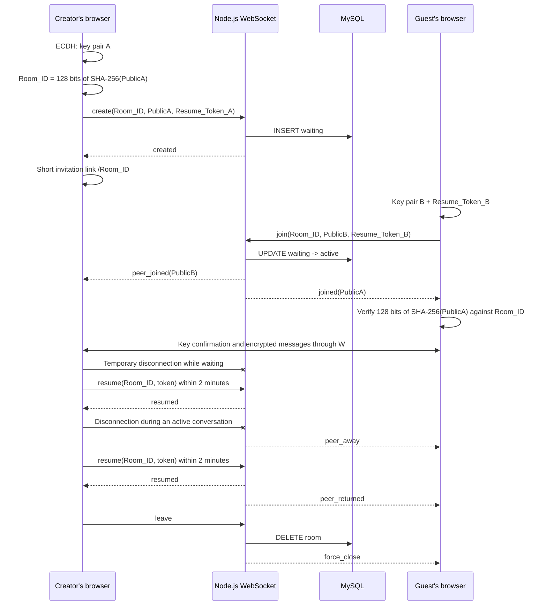

# burnit.chat

A disposable 1:1 chat with no accounts or message history. Browsers establish
a shared secret using ECDH P-256, derive two directional AES-256-GCM keys
using HKDF-SHA-256, and send only encrypted envelopes through the relay.

Project documentation:

- [DOCUMENTATION.md](DOCUMENTATION.md) — configuration, worker behavior, and the complete protocol.
- [key-exchange.md](key-exchange.md) — a step-by-step introduction to ECDH,
  HKDF, AES-GCM, the handshake, and session resumption.
- [SECURITY.md](SECURITY.md) — threat model and security limitations.

## Architecture

- `index.php`, `*.html` templates, `config.js`, `assets/` — bilingual
  frontend and browser-side cryptography.
- `lib/locale.php`, `data/pl-ip-ranges.json` — local IP-based language
  selection without sending the address to an external service.
- `server/node-relay.cjs` — production HTTP/WebSocket relay for Node.js.
- `database/schema.sql` — a table that stores only room state.
- `server/server.php` — legacy PHP CLI relay, incompatible with the current
  protocol and retained only for reference.
- `test/` — cryptography and full WebSocket protocol tests.
- `tools/push.py` — controlled deployment of the frontend and Node.js application over SSH.

The relay never receives private keys, AES keys, or plaintext messages.
MySQL stores only the room ID, its status, and its creation time.



## Local setup

Use a current Node.js LTS release. The minimum supported version is Node.js 18.

```powershell
npm install
npm run check
npm test
npm run test:integration
```

Start the relay by double-clicking:

```text
server\start-relay.cmd
```

Or run it from a terminal:

```powershell
npm start
```

The local relay listens at `ws://localhost:8080/ws`. When opened through
Laragon at `http://localhost/safechat/`, the frontend uses this address
automatically. The configuration no longer includes the laptop's LAN address.

The language is selected automatically: Polish for IP ranges assigned to
Poland by RIPE NCC, and English for all others. The flag buttons save a manual
selection in the `burnit_lang` cookie. To update the local IP range list and
rebuild the English pages:

```powershell
python tools\update-polish-ip-ranges.py
python tools\build-english-pages.py
```

In development, the database is optional and the relay can keep rooms entirely
in memory. To use MySQL locally, set the `BURNIT_DB_*` variables described in
`.env.example`.

## Production deployment on CAL.pl

The frontend is deployed to:

```text
/home/pemoarts/domains/burnit.chat/public_html
```

The Node.js application is deployed separately to:

```text
/home/pemoarts/domains/burnit.chat/node_app
```

Preview the complete deployment plan before uploading:

```powershell
python tools\push.py --dry-run
```

The script uploads an explicit list of Polish and English templates, PHP
language-selection files, the local IP range list, `config.js`, and `assets/`
to `public_html`. It uploads only these files to `node_app`:

- `app.cjs` — a copy of `server/node-relay.cjs`.
- `package.json`.
- `package-lock.json`.

It does not upload `.env`, database passwords, logs, tests, or `node_modules`.
When deploying the Node component, the script reads the hosting account's
process list, stops only workers with the exact burnit.chat application title,
and then sets the LiteSpeed restart marker. It does not use a broad
`pkill node`, so other Node applications on the same account are unaffected.
Finally, it checks `https://burnit.chat/ws/` for up to 45 seconds. Deployment
succeeds only after an HTTP 200 response with the relay's status JSON and a
successful WSS test: `connect → create → created → leave`.

### Node.js application settings

Use these settings in the Node.js control panel:

| Field | Value |
|---|---|
| Node.js version | Latest available LTS, minimum 18 |
| Application mode | `Production` |
| Application root | `domains/burnit.chat/node_app` |
| Application URL | Domain `burnit.chat`, path `/ws` |
| Application startup file | `app.cjs` |

Do not select Node.js 10.24.1 shown in the screenshot; that version no longer
receives security updates. After uploading the files, install the NPM
dependencies from the control panel, then restart the application.

### Environment variables

Production requires:

| Variable | Value or description |
|---|---|
| `BURNIT_ALLOWED_ORIGINS` | `https://burnit.chat,https://www.burnit.chat` |
| `BURNIT_WS_PATH` | `/ws` |
| `BURNIT_LOG_LEVEL` | `info` |
| `BURNIT_RECONNECT_GRACE_MS` | `120000` |
| `BURNIT_DB_HOST` | MySQL host, usually `localhost` |
| `BURNIT_DB_PORT` | `3306` |
| `BURNIT_DB_NAME` | Database name from the control panel |
| `BURNIT_DB_USER` | Database user from the control panel |
| `BURNIT_DB_PASSWORD` | A new password, set only in the control panel |

`Production` mode sets `NODE_ENV=production`. In this mode, incomplete database
configuration prevents the application from starting rather than allowing it
to run without the required safeguards.

On its first start, the relay creates the `rooms` table automatically and
removes orphaned records. During a standard Node startup, it also acquires a
MySQL lock to enforce a single instance. On CAL.pl, this lock is skipped
because LiteSpeed starts a new worker before shutting down the previous one
during a graceful restart. If the database account does not have `CREATE`
permission, import `database/schema.sql` through phpMyAdmin beforehand.

After startup, an HTTP request to:

```text
https://burnit.chat/ws/
```

should return:

```json
{"service":"burnit.chat-relay","status":"ok"}
```

To test the full protocol against the public endpoint:

```powershell
$env:BURNIT_TEST_WS = 'wss://burnit.chat/ws/'
npm run test:integration
```

## Relay configuration

| Variable | Default value |
|---|---|
| `PORT` | `8080` locally; Passenger manages the port on the hosting platform |
| `BURNIT_WS_PATH` | `/ws` |
| `BURNIT_WAITING_TTL_MS` | `900000` |
| `BURNIT_RECONNECT_GRACE_MS` | `120000` |
| `BURNIT_INITIAL_REQUEST_TIMEOUT_MS` | `20000` |
| `BURNIT_MAX_FRAME_BYTES` | `70000` |
| `BURNIT_RATE_LIMIT_MESSAGES` | `60` |
| `BURNIT_RATE_LIMIT_WINDOW_MS` | `10000` |
| `BURNIT_LOG_LEVEL` | `info` in production, `debug` locally |

Technical logs go to the application's standard output, managed by the
control panel. They contain no IP addresses, keys, message contents, or
ciphertext.

While waiting and during an active conversation, the frontend uses Screen
Wake Lock to reduce the risk of the phone's screen turning off and the
WebSocket disconnecting. The browser releases the lock when the tab is
hidden, so the application requests it again when the tab becomes visible.
If the system interrupts the WebSocket, the creator of a waiting room can
resume it within 2 minutes using a private token stored only in that tab's
memory. The token is not part of the invitation or the MySQL record. If a
guest opens the link while the creator is away, the guest's page automatically
retries `join` every 3 seconds for up to 2 minutes, without requiring a manual
refresh.

Once the conversation starts, both the creator and the guest have their own
private resume token. A temporary WebSocket disconnection pauses sending but
preserves AES keys and sequence counters. Each participant has up to 2
minutes to return, at which point the worker reconnects the sockets.
Explicitly ending the conversation still burns the room immediately.

## Important security limitations

The complete invitation link is a bearer secret: anyone who obtains it before
the first guest joins can take the guest's place. For high-risk conversations,
both participants should compare the security code through another channel.
See [SECURITY.md](SECURITY.md) for details.

The internal `safechat:v1` labels identify the cryptographic protocol version.
They are not the public product name and must not be changed without a
protocol migration.
