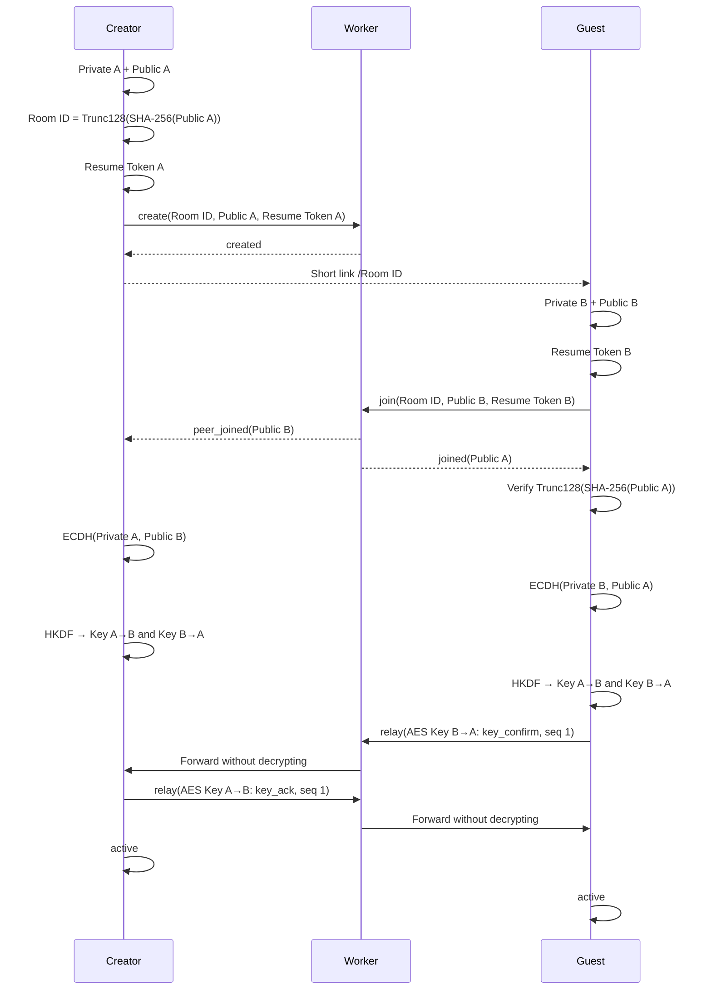

# From ECDH to AES-GCM — key exchange in burnit.chat

This document explains how burnit.chat establishes an encrypted channel,
step by step: from ECDH key generation, through the short invitation link
and WebSocket handshake, to AES-GCM message encryption.

The description matches the implementation in `assets/crypto.js`,
`assets/app.js`, and `server/node-relay.cjs`.

## 1. Participants and two layers of protection

The participants are:

- **Creator (A)** — creates the room.
- **Guest (B)** — is the first person to open the invitation.
- **Worker (W)** — manages the room and forwards WebSocket frames.

The connection has two independent layers:

1. **HTTPS/WSS (TLS)** protects transport from each browser to the hosting
   platform.
2. **E2EE** encrypts the content inside WSS using keys known only to the
   browsers.

TLS terminates at the server. E2EE terminates only in the other browser.

## 2. The intuition behind ECDH

### 2.1. A shared public starting point

P-256 defines public curve parameters, including the base point `G`.
Both participants, the worker, and any observer know these parameters.

### 2.2. Two independent key pairs

Each browser generates its own random private scalar and calculates the
corresponding public point:

```text
Creator:
Private A = dA
Public A  = dA · G

Guest:
Private B = dB
Public B  = dB · G
```

`Private A` and `Private B` never leave their respective browsers. Public
keys can be transmitted openly.

### 2.3. The same secret on both sides

After exchanging public keys, each participant performs scalar multiplication:

```text
Creator: Shared Secret A = dA · Public B = dA · (dB · G)
Guest:   Shared Secret B = dB · Public A = dB · (dA · G)
```

Both results correspond to the same point, `dA · dB · G`. An observer who
knows `G`, `Public A`, and `Public B` still does not know `dA` or `dB`.
Recovering a private scalar from a public point would require solving the
elliptic-curve discrete logarithm problem.

Through `ECDH deriveBits`, Web Crypto returns the same 256 bits of secret
material to both participants.

## 3. Step 1 — the creator generates keys and a short identifier

After clicking “Create a chat”, the creator's browser generates:

1. A P-256 key pair: `Private A` and `Public A`.
2. A random 256-bit `Resume Token A`.
3. A `Room ID` calculated from `Public A`.

The public key is exported in uncompressed format:

```text
0x04 || X (32 bytes) || Y (32 bytes)
```

It is 65 bytes long, or 87 base64url characters.

### 3.1. Room ID as a key commitment

Instead of placing the entire 87-character key in the link, the browser
calculates:

```text
Digest  = SHA-256(raw Public A)
Room ID = base64url(first 16 bytes of Digest)
```

`Room ID` contains 128 bits and is 22 base64url characters long. It serves
two purposes:

- An unpredictable room identifier.
- A cryptographic commitment to `Public A`.

The commitment means that, after receiving the full `Public A`, the guest
can verify that it is exactly the key associated with the invitation.

## 4. Step 2 — `create` sends Public A to the worker

The creator opens a WSS connection and sends:

```json
{
  "type": "create",
  "roomId": "<22 characters>",
  "publicKey": "<Public A: 87 characters>",
  "resumeToken": "<Resume Token A: 43 characters>"
}
```

The worker:

1. Decodes and validates the format of `Public A`.
2. Calculates `Trunc128(SHA-256(raw Public A))`.
3. Requires the result to match `Room ID` exactly.
4. Stores only `Room ID`, the `waiting` status, and the time in MySQL.
5. Keeps `Public A` and `SHA-256(Resume Token A)` only in RAM.
6. Responds with `created`.

The worker knows the creator's public key, but not `Private A`.

## 5. Step 3 — the short link is created

The invitation has this format:

```text
https://burnit.chat/<Room ID>
```

It no longer contains `#PublicA`. The link does not include:

- The full `Public A`.
- `Private A`.
- The resume token.
- The shared secret.
- AES keys.

However, `Room ID` is a single-use bearer invitation. The first person who
knows the link can try to take the guest's place.

## 6. Step 4 — the guest prepares their browser

After the link is opened, the guest's browser:

1. Reads and validates `Room ID`.
2. Generates `Resume Token B` from 32 random bytes.
3. Generates a P-256 key pair: `Private B` and `Public B`.
4. Opens a WSS connection.

At this point, the guest does not yet know the full `Public A`, so ECDH is
not performed.

## 7. Step 5 — the worker exchanges public keys

The guest sends:

```json
{
  "type": "join",
  "roomId": "<Room ID>",
  "publicKey": "<Public B>",
  "resumeToken": "<Resume Token B>"
}
```

The worker changes the state atomically:

```text
waiting → active
```

Only the first valid `join` can succeed. The worker then:

1. Keeps `SHA-256(Resume Token B)` in RAM.
2. Sends the creator:

   ```json
   {
     "type": "peer_joined",
     "publicKey": "<Public B>"
   }
   ```

3. Sends the guest:

   ```json
   {
     "type": "joined",
     "publicKey": "<Public A>"
   }
   ```

The worker exchanges public keys but never receives private keys.

## 8. Step 6 — the guest verifies Public A

The guest does not unconditionally trust the key returned by the worker.
First, the guest calculates:

```text
Expected Room ID = base64url(Trunc128(SHA-256(raw received Public A)))
```

The guest then compares `Expected Room ID` with the identifier in the link.

If the values differ:

- ECDH is not performed.
- The channel is closed.
- The key supplied by the worker is treated as substituted or corrupted.

A malicious worker cannot substitute a different `Public A` undetected
unless it finds another valid P-256 key with the same 128-bit commitment.

## 9. Step 7 — both participants calculate the Shared Secret

After verification:

```text
Guest:   Shared Secret = ECDH(Private B, Public A)
Creator: Shared Secret = ECDH(Private A, Public B)
```

Both participants obtain the same material. The worker knows both public
keys but cannot perform either calculation without `Private A` or `Private B`.

## 10. Step 8 — HKDF creates two AES keys

The shared ECDH material is not used directly as an AES key. HKDF binds the
keys to the specific session and assigns separate purposes to them.

Conceptually, HKDF performs:

```text
PRK = HMAC-SHA-256(Salt, Shared Secret)
Output Key = HKDF-Expand(PRK, info, 32 bytes)
```

### 10.1. Salt bound to the room and keys

Both participants construct:

```text
safechat:v1:<Room ID>:<Public A>:<Public B>
```

And calculate:

```text
Salt = SHA-256(UTF8(the text above))
```

Changing the room or either public key produces different AES keys.

### 10.2. Separate directions

HKDF-SHA-256 is performed with two `info` values:

```text
Key A→B:
info = "safechat:v1:creator-to-guest"

Key B→A:
info = "safechat:v1:guest-to-creator"
```

| Role | Sending key | Receiving key |
|---|---|---|
| Creator | `Key A→B` | `Key B→A` |
| Guest | `Key B→A` | `Key A→B` |

Both results are non-exportable AES-256-GCM keys. Separating the directions
protects against reflection attacks, among other threats.

## 11. Step 9 — the `key_confirm → key_ack` handshake

Deriving the keys does not open the chat yet. The participants verify in
practice that they can encrypt and decrypt in both directions.

### 11.1. The guest sends `key_confirm`

The guest encrypts the following using `Key B→A`:

```json
{
  "kind": "key_confirm",
  "seq": 1,
  "sentAt": 1710000000000,
  "proof": "safechat-v1"
}
```

### 11.2. The creator responds with `key_ack`

The creator decrypts the confirmation using `Key B→A`, checks the tag, AAD,
`kind`, `proof`, and `seq`, then encrypts the following using `Key A→B`:

```json
{
  "kind": "key_ack",
  "seq": 1,
  "sentAt": 1710000000001,
  "proof": "safechat-v1"
}
```

The creator enters `active` after sending a valid `key_ack`. The guest does
so after successfully decrypting it. The handshake has a 15-second timeout.

The worker sees only two `relay` envelopes. It does not know the values of
`kind`, `proof`, `seq`, or `sentAt`.

## 12. How a message is encrypted

Before encryption, the browser constructs:

```json
{
  "kind": "message",
  "seq": 2,
  "sentAt": 1710000001234,
  "text": "Example message"
}
```

The first handshake message used `seq = 1`, so each participant's first
regular message has `seq = 2`.

### 12.1. IV

For each envelope, the browser generates a new random 12-byte IV:

```text
IV = random(96 bits)
```

The IV is not secret, but it must never be reused with the same AES-GCM key.

### 12.2. AAD

The unencrypted but authenticated data has this format:

```text
safechat:v1:<Room ID>:<sender role>
```

AAD binds the ciphertext to the protocol version, room, and role. An envelope
moved to another room or direction will fail tag verification.

### 12.3. AES-256-GCM

The browser performs:

```text
AES-GCM(
  key = directional sending key,
  iv = 12 random bytes,
  additionalData = AAD,
  tagLength = 128 bits,
  plaintext = UTF8(JSON)
)
```

Web Crypto returns the ciphertext with a 128-bit tag appended. The tag is
not a separate protocol field.

The worker receives:

```json
{
  "v": 1,
  "iv": "<base64url>",
  "ciphertext": "<encrypted payload and tag as base64url>"
}
```

## 13. What the receiver checks

The receiver:

1. Requires `v = 1`.
2. Requires a 12-byte IV.
3. Reconstructs AAD for the sender's role.
4. Verifies the tag and decrypts using AES-GCM.
5. Decodes UTF-8 and JSON.
6. Requires exactly the next `seq` number.
7. Checks `kind` against the current phase.

An invalid tag, a different room or role, replay, a skipped sequence number,
or reordering closes the channel.

## 14. Security code

Both participants calculate:

```text
Verification Digest = SHA-256(Shared Secret || Salt)
```

The application takes the first 4 bytes, interprets them as an unsigned
integer, takes the remainder modulo `1 000 000 000`, and displays 9 digits:

```text
123 456 789
```

Comparing the code through another trusted channel detects key-exchange
substitution, including a worker attempting to impersonate the guest to
the creator.

burnit.chat has no accounts or long-term identity keys, so the code does not
automatically confirm who the other participant is.

## 15. Complete flow



## 16. What is generated and what is transmitted

| Value | Where it is generated | Whether it is transmitted |
|---|---|---|
| `Private A` | Creator, ECDH key generator | Never |
| `Public A` | Creator, from `Private A` | Yes: `create`, then `joined` to the guest |
| `Room ID` | Creator, hash of `Public A` | Yes: in the link and protocol |
| `Resume Token A` | Creator, 32 random bytes | Yes: WSS `create/resume` |
| `Private B` | Guest, ECDH key generator | Never |
| `Public B` | Guest, from `Private B` | Yes: `join`, then `peer_joined` to the creator |
| `Resume Token B` | Guest, 32 random bytes | Yes: WSS `join/resume` |
| `Shared Secret` | Both browsers independently | Never |
| `Salt` | Both browsers independently | No; derived from public data |
| `Key A→B` | Both browsers independently | Never |
| `Key B→A` | Both browsers independently | Never |
| IV | Sender, separately for each envelope | Yes, unencrypted |
| Ciphertext and tag | Sender, using AES-GCM | Yes; the worker only forwards them |

The participants exchange **public** keys but derive the final AES keys
locally. AES keys are never transmitted.

## 17. Returning after a WebSocket disconnection

A resume token is not an encryption key. It is used only to recover a role
and the WebSocket transport.

When an active participant loses their connection:

1. The worker preserves the room for up to 2 minutes.
2. The other participant receives `peer_away`.
3. The disconnected participant sends `resume` over a new WSS connection.
4. The worker restores their role and sends `peer_returned`.

The browser preserves the same `SecureChannel`:

- It does not generate a new ECDH key pair.
- It does not perform HKDF again.
- It does not change AES keys or the security code.
- It does not reset `seq` counters.

This works only if the system has kept the same tab in memory. Refreshing
or closing the tab removes the token and keys.

## 18. Who knows which data

| Data | Creator | Guest | Worker | MySQL |
|---|:---:|:---:|:---:|:---:|
| `Room ID` | Yes | Yes | Yes | Yes |
| `Public A` | Yes | Yes | Yes, in RAM | No |
| `Private A` | Yes | No | No | No |
| `Public B` | Yes | Yes | Yes, during `join` | No |
| `Private B` | No | Yes | No | No |
| `Shared Secret` | Yes | Yes | No | No |
| `Key A→B` | Yes | Yes | No | No |
| `Key B→A` | Yes | Yes | No | No |
| Resume tokens | Own token | Own token | Only SHA-256 hashes in RAM | No |
| Plaintext message | Yes | Yes | No | No |
| IV and ciphertext | Yes | Yes | Yes, in transit | No |

## 19. Security limitations

The model provides:

- Content confidentiality against a passive worker.
- Integrity through AES-GCM.
- Pinning of `Public A` through the 128-bit `Room ID`.
- Direction separation through HKDF.
- Binding of the envelope to the room and role through AAD.
- Replay protection through `seq`.

The model does not provide:

- Automatic verification of the other participant's identity.
- Protection against a compromised frontend serving modified JavaScript.
- Protection against an invitation being stolen before its first use.
- A ratchet that changes the key for each message.
- Concealment of IP addresses, frame timing, or frame sizes.

The creator's invitation contains no commitment to the future `Public B`.
A malicious worker can try to impersonate the guest to the creator;
comparing the security code through another channel detects this substitution.

Removing references to keys limits their lifetime, but JavaScript and the
garbage collector do not guarantee immediate physical memory zeroing.
